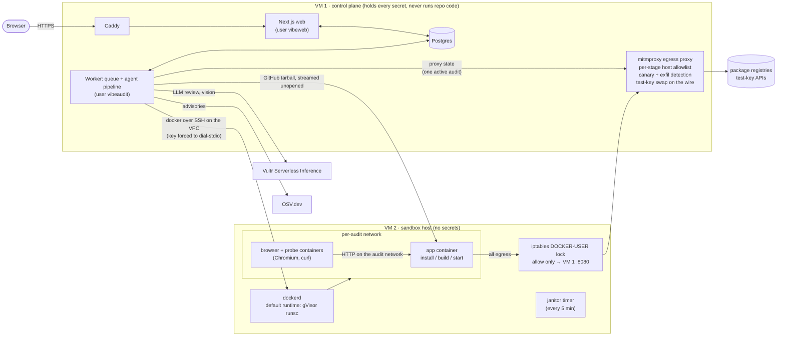

# VibeAudit

**Audits AI-generated web apps by running them, safely.** Paste a GitHub URL. VibeAudit installs, builds and starts the app inside a locked-down sandbox, attacks it the way a stranger on the internet would, and returns a scorecard. Every finding carries evidence: the code line, the HTTP response or the screenshot that proves it.

Built for the Vultr Agent Rush hackathon, "Blast Radius Zero" challenge. The idea is to run code you don't trust and prove that nothing it does can escape.

Live: **https://108-61-149-76.sslip.io**

> The point is that "vibe-coded" apps are mostly reviewed by reading. Reading misses things that only show up at runtime: an admin page served to anyone, an API that dumps the user table, an install script that phones home. VibeAudit runs the app to find them. Running hostile code is only acceptable if the blast radius is zero, so most of this repo is about containment.

---

## What an audit checks

| Area | How | Evidence |
|---|---|---|
| **Missing auth, IDOR, forged-header admin, open AI proxy, debug dumps, stack traces, wildcard CORS** | HTTP probes against the running app | the request and response |
| **Pages served to logged-out visitors** (admin consoles, dashboards) | headless Chromium visits common paths with no session. A vision model judges each non-home page that loaded (up to 6, skipping login pages), and page text with real-looking records makes the finding high and confirmed | screenshot + page text |
| **Secrets** in the repo, a committed `.env` or the client bundle | pattern scan of the source and of the built bundle (`.next/static`, `dist`). The build is seeded with marker values, so a server secret that leaks into browser code is caught | code line (values masked) |
| **Malicious install scripts** | static read of every `preinstall`/`install`/`postinstall` hook (the repo's and its dependencies') down to the code it runs. Flagged even when the audit installs with `--ignore-scripts` | code lines |
| **Supply-chain behaviour at install/build** | the sandbox logs the connections it blocks; blocked egress during install or build is a finding | firewall or proxy log row |
| **Secret exfiltration** | a canary value is planted in the env; if it leaves the sandbox the proxy catches it | proxy log row |
| **Known-vulnerable and known-malicious packages** | installed package list checked against OSV.dev (`MAL-*` advisories are critical) | advisory + version |
| **Logic flaws you can't prove by running** (plaintext password checks, `innerHTML` XSS…) | LLM code review, reported as *unconfirmed* and weighted at half | code line |

The score starts at 100 and drops per finding by severity:
- Confirmed findings (proven at runtime, a real key format in a file, a known-malicious package) count fully. Unconfirmed ones (LLM review, install-script heuristics, dependency advisories) count at half.
- Dependency advisories are capped as a group at 30 points; known-malicious packages are outside the cap.
- A repo with critical supply-chain behaviour (a malicious install hook, say) is capped at 40, whether or not the hook actually ran.

Supported stacks for the runtime pass are Next.js, Vite/React and Express (Node). Anything else, or an app whose install fails or that won't build or start, gets a static-only report that says why. An install that hits its time limit fails the audit instead.

## How an audit runs

```
intake → plan → approve → static → install → build → run → dynamic → verify → report
```

1. **intake:** resolve the repo and stream its tarball from GitHub straight into the sandbox. The control plane never unpacks it.
2. **plan:** read `package.json` in the sandbox and detect the framework, package manager and install/build/start commands. The app is started with `PORT=3000`. It gets planted values, never real ones:
   - a canary (`AKIAVIBE…`) that makes exfiltration visible;
   - for known API-key vars (OpenAI, Anthropic, Stripe, Gemini), a placeholder, but only when the user supplies a test key.
3. **approve:** the audit pauses for a human. The UI shows the exact commands, the env plan and the repo's own install hooks. The user can approve (optionally with `--ignore-scripts` and their own test keys), choose a static-only audit, or cancel.
4. **static:** secret scan, install-script scan of the repo's hooks, LLM review and a pre-install package snapshot. These happen before any repo code runs, so a hostile install can't rewrite what gets read. Dependencies' install hooks are read from `node_modules` right after install.
5. **install / build / run:** each step runs in its own gVisor container with time and resource caps. Egress goes only through the proxy, whose rules tighten per stage.
6. **dynamic:** HTTP probes, then the logged-out browser pass with screenshots.
7. **verify:** a vision model checks the screenshots for exposed data.
8. **report:** OSV dependency audit, the containment log and the score. Then every container, the network and the workspace are destroyed.

Progress streams to the browser live over SSE. The whole audit has a 20-minute cap, not counting the approval wait. On a timeout the containers are killed and the audit fails with what it found so far.

## Architecture



### The trust boundary

- **VM 1 never executes or unpacks repo code.** It downloads the tarball and pipes it into a sandbox container.
  - Everything that comes back (file contents, build logs, page text, model output) is treated as untrusted. It is parsed, masked and escaped, never evaluated.
  - The LLMs have no tools. Their output is validated JSON, and the snippet a finding shows is taken from the real source line, not from the model's claim.
- **VM 2 holds no secrets.** Repo code only ever runs through `docker run` under gVisor. The flags are built in one place, `containerArgs()` in `packages/shared/src/sandbox.ts`:
  - `--cap-drop ALL`, `no-new-privileges`, a non-root user;
  - pids, CPU and memory caps;
  - the per-audit network and the workspace mount.

  The rootfs is memory-backed (runsc `--overlay2=root:memory` in the daemon config), and the workspace lives on a size-capped loop-mounted filesystem. Each stage has a time limit (install 4 min, build 3 min, run 6 min).

  Repo Dockerfiles are never built, because BuildKit `RUN` steps would escape gVisor.
- **Egress lock.** Outside their own audit network, sandbox containers can reach exactly one address: the proxy on VM 1. This is enforced by iptables on the container bridges, keyed on interfaces rather than source addresses, so even spoofed packets are dropped.
  - DNS doesn't resolve externally, and raw TCP, UDP and IP-literal hosts are blocked.
  - Ports are limited to 80 and 443, and upstreams must resolve to public IPs.
  - Install and build may only `GET`/`HEAD` a short per-stage allowlist: package registries, GitHub, nodejs.org and Prisma binaries at install; Google Fonts and Prisma binaries at build.
  - At run time the only hosts allowed are the ones the user's test keys are scoped to; with no keys, nothing is.
  - Allowed, blocked and dropped connections are recorded in the report's containment log (repeats are rate-limited and counted).
- **Keys never enter the sandbox.** The app sees `sk-PLACEHOLDER-<VAR>-<auditId>`. The proxy swaps in the user's real test key only on requests to that provider's own hosts.
  - A canary value (`AKIAVIBE…`) in the env makes exfiltration attempts visible.
- **Least privilege on VM 1.**
  - The web app runs as its own user and can't read the worker's SSH key or the proxy directory, or use Docker.
  - The worker's key into VM 2 is restricted to the VPC source address and forced to `docker system dial-stdio`.
- **Nothing outlives an audit.** Teardown runs on success and on failure. The VM 2 janitor removes anything a crashed worker left behind: containers after 30 minutes, networks and workspaces after 90.

`infra/sbx/selftest.sh` checks these claims on the live host. It covers:
- internet, cloud metadata, VM 1's SSH and Postgres, and the host's own ports are unreachable (the proxy port is checked as reachable);
- external DNS fails;
- spoofed-source raw packets under runc are dropped;
- a fork bomb hits the pids cap;
- a 1.5 GB rootfs write is stopped by the memory cap.

`infra/cp/proxy/selftest.sh` does the same for the proxy.

## Vultr services used

| Service | Used for |
|---|---|
| **Cloud Compute**: 2 VMs | VM 1 control plane (vc2, 2 vCPU / 4 GB); VM 2 sandbox host (2 vCPU / 8 GB) |
| **VPC** | Private network between the VMs. The worker drives Docker on VM 2 over it, and sandbox egress reaches the proxy over it |
| **Firewall groups** (set in the Vultr console) | Public SSH limited to the admin IP; only 80/443 open on VM 1. Host-level ufw rules also cover VPC traffic, which Vultr firewall groups don't filter |
| **Serverless Inference** (`api.vultrinference.com/v1`) | the code review model (`PLANNER_MODEL`, we use `glm-5.3`) and the multimodal screenshot judge (`VISION_MODEL`, we use `glm-5.3-flash`) |

## Demo targets

Two public repos made to be audited (also in [`demos/`](demos/)):

- [**demo-vulnerable**](https://github.com/sobanali256/demo-vulnerable): an Express notes app with planted flaws. These are an open user API, IDOR, a header-trusted admin action, an open `/admin` console, secrets in `.env` and in the client bundle, and more. Expected score: 0.
- [**demo-malicious**](https://github.com/sobanali256/demo-malicious): a benign-looking app whose `postinstall` reads the environment and opens a raw connection out. It is deliberately neutered and never sends a secret. The sandbox drops the connection and the report flags it as critical. The repo is flagged even with `--ignore-scripts`, when the hook never runs.

> **Never `npm install` anything in `demos/` on your own machine.** Their install scripts are hostile by design.

## Repository layout

```
apps/web          Next.js 16 UI + API: submit, approval panel, live progress (SSE), scorecard
apps/worker       job queue + audit pipeline (planner, scanners, probes, browser, vision, scoring)
packages/shared   types shared by web and worker: stages, limits, finding schema, container flags
packages/db       Postgres schema, migrations and queries
infra/cp          VM 1 provisioning: app host, Caddy, Postgres, service users, egress proxy
infra/sbx         VM 2 provisioning: Docker + gVisor, egress lock, workspace volume, janitor, selftest
infra/common      SSH hardening for both VMs
infra/deploy.sh   ships the committed HEAD to VM 1, health-checks, rolls back on failure
sandbox/          the stock images audits run on
demos/            intentionally vulnerable / hostile audit targets (do not run locally)
```

## Development

Requires Node ≥ 22 and pnpm 11.

```bash
pnpm install
pnpm db:up          # local Postgres (docker-compose.dev.yml)
pnpm dev            # web + worker
pnpm test           # vitest, all packages
pnpm typecheck
pnpm lint
```

The worker reads `process.env` only: export the variables from `.env.example` (for example `set -a; . ./.env; set +a`). It refuses to start without `VULTR_INFERENCE_API_KEY`, `PLANNER_MODEL` and `SANDBOX_DOCKER_HOST`. The web app needs `DATABASE_URL` in `apps/web/.env.local`. The UI, the database and all unit tests run locally. A real audit needs a sandbox host: the worker reaches one through `SANDBOX_DOCKER_HOST` and expects the egress proxy at `SANDBOX_PROXY_URL`. Don't point it at your own Docker daemon. The containment guarantees come from the VM 2 setup (gVisor, the egress lock, the workspace volume), not from the worker.

### Deploying your own

1. Create two VMs on a shared VPC. Add SSH aliases `vibe-cp` (VM 1) and `vibe-sbx` (VM 2), and harden both with `ssh vibe-cp 'bash -s' < infra/common/harden-ssh.sh` (and the same for `vibe-sbx`).
2. Set up VM 2: `bash infra/sbx/install.sh`, then `ssh vibe-sbx 'bash -s' < infra/sbx/selftest.sh`. Every line should say PASS.
3. Set up VM 1:
   1. Create `/etc/vibeaudit/env` (owned by root, mode 600) with `VULTR_INFERENCE_API_KEY`, `PLANNER_MODEL` and, optionally, `VISION_MODEL`.
   2. `bash infra/cp/install-proxy.sh` installs the proxy and copies its public CA to VM 2.
   3. `bash infra/cp/install-app.sh` sets up the app host and authorises the worker's restricted key on VM 2.
4. Deploy with `DEPLOY_WORKER=1 bash infra/deploy.sh`.

The scripts default to this project's addresses and NIC names (`CP_VPC_IP`, `SBX_VPC_IP`, `PUBLIC_IP`, `VPC_IF`, `PUB_IF`). The setup scripts run on the VMs over `ssh … 'bash -s'`, which doesn't forward local env, so for your own VMs change the defaults at the top of the `infra/` scripts.

## Limitations

- Only GitHub URLs are accepted; zip upload is not implemented. Runtime auditing covers Node web apps only.
- One audit runs at a time: the proxy has a single active-audit state, and VM 2 is sized for one. Extra audits queue.
- The probes target the common shapes of AI-generated apps (`/api/users`, `/api/debug`, `/admin`…). A flaw on an unusual route may only show up as an LLM suspicion, or not at all. The browser pass is logged-out only.
- The install-script scanner follows hooks into the code they run, including through shell, `npm run` chains, preloads and tool configs. A fully dynamic load (a computed `require` path, `eval` of a data file) can still hide code from it.
  - Repo code it can't fully read is reported as "could not be fully checked", not passed.
  - Registry dependencies also rely on OSV and on runtime containment.
- LLM findings are suggestions. They are marked unconfirmed and count half.

## License

MIT, see [LICENSE](LICENSE).
